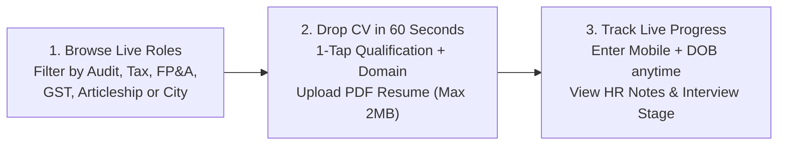
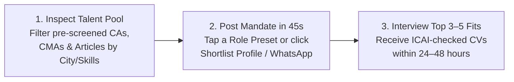

<div align="center">

# FinTalent Partners

### **Fast-Track Finance, Chartered Accountancy & Tax Recruitment Across India**

*Zero scroll fatigue. Zero candidate fees. 60-second applications for talent & 48-hour vetted shortlists for firms.*

[](#)
[](#for-candidates--job-seekers)
[](#for-recruiters-ca-firms--cfos)
[](https://wa.me/919821262613?text=Hi%20Ami%20Bhanushali%2C%20reaching%20out%20via%20FinTalent%20Partners)

<br />


<br />

[**For Candidates**](#for-candidates--job-seekers) · [**For Recruiters & Firms**](#for-recruiters-ca-firms--cfos) · [**Domains & Salary Bands**](#practice-verticals--typical-compensation) · [**Live Status Tracker**](#passwordless-5-stage-application-tracker) · [**Executive Desk Contact**](#direct-executive-search-desk) · [**Developer Guide**](#engineering--local-setup)

</div>

---

## Why FinTalent Partners?

Traditional job portals bury candidates behind 10-page forms and flood hiring managers with hundreds of unscreened resumes.

**FinTalent Partners** is built around **speed, human domain screening, and transparency** — led directly by **Ami Bhanushali** and a specialized Chartered Accountancy & Corporate Finance search desk serving **Mumbai (BKC)**, **Delhi NCR (Connaught Place)**, **Bengaluru (Indiranagar)**, **Pune**, and **Pan-India**.

| What Matters Most | Traditional Job Portals | FinTalent Partners Studio |
| :--- | :--- | :--- |
| **Candidate Application Time** | 15–20 mins across multi-step signup forms | **Under 60 seconds** — 1-screen form, no account wall |
| **Candidate Placement Fee** | Paid "priority boosts" & upsells | **₹0 Forever — 100% Free** at every stage |
| **Application Visibility** | Black-hole applications with zero feedback | **Live 5-Stage Pipeline Tracker** via Mobile + DOB |
| **Recruiter Resume Quality** | 200+ unfiltered keyword matches | **3–5 ICAI-verified, technically screened profiles** |
| **Recruiter Turnaround** | Weeks of manual screening | **24 to 48 hours** for core CA, Tax & Finance roles |
| **Human Accountability** | Automated bots only | **Direct WhatsApp & phone access** to Ami Bhanushali's desk |

---

## For Candidates & Job Seekers

> **Who we place:** Qualified Chartered Accountants (CA), CA Inter / Semi-Qualified Professionals, CA Article Assistants & Industrial Trainees, CMAs, ACCA / CS / CFA Charterholders, MBA (Finance), and Senior Accountants / ERP Controllers.

### How to Apply in 3 Simple Steps



1. **Explore Real Open Mandates Immediately**
   - Switch to **I'm Looking for a Job** on the home screen to see live active roles with transparent LPA / monthly stipend bands and work locations.
   - Spot a role you like? Click **`Apply in 60s`** — your target role, domain, city, and expected compensation automatically pre-fill in the form below.
2. **Submit Once — Reach 40+ Vetted Firms & Corporates**
   - No repetitive typing: tap quick presets for **Qualification**, **Practice Domain**, **Experience**, **City**, and **Expected CTC**, attach your **PDF Resume**, and submit in one click.
   - Strictly confidential: your resume is shared **only** with verified hiring partners where your profile fits.
3. **Track Your Status Anytime (Zero Password Needed)**
   - Your **10-Digit Mobile Number + Date of Birth** act as your private tracking passkey so you always know exactly where your application stands.

---

## For Recruiters, CA Firms & CFOs

> **Who hires with us:** Top 20 & Mid-Sized Chartered Accountancy Firms, Boutique Tax & Litigation Practices, MNC Shared Service Centers, and Series A–D Venture-Backed Startups.

### How Hiring Works in 48 Hours



- **Browse Ready-to-Interview Profiles Instantly**: Switch to **`I'm Hiring Talent`** / **`Talent Pool`** to view anonymized pre-vetted candidates with qualification pedigree (e.g., *1st Attempt CA, Big 4 Articleship, SAP S/4 HANA FICO*), notice period, city, and CTC expectations.
- **1-Tap Role Quick-Fill**: Select presets like *Statutory Audit Senior*, *Startup FP&A Lead*, *GST Litigation Lead*, *Direct Tax Manager*, *CA Article Trainee*, or *SAP Controller* to submit a hiring mandate in **under 45 seconds**.
- **Risk-Free Partnership**:
  - **Zero upfront retainer** — success-linked placement structure
  - **ICAI credential, attempt count & articleship verification** performed upfront
  - **90-day replacement cover** on corporate mandates

---

## Practice Verticals & Typical Compensation

| Practice Vertical | Common Roles Placed | Typical Compensation / Stipend | Primary Hiring Partners |
| :--- | :--- | :--- | :--- |
| **Statutory Audit & Assurance** | Audit Senior / Manager, Ind AS Reviewer, IFC & CARO Lead | **12 – 24 LPA** | Top 20 CA Firms & MNC Assurance Desks |
| **FP&A & Corporate Finance** | FP&A Manager, Strategic Finance Lead, M&A Valuation | **16 – 32 LPA** | Series A–D Startups, Unicorns & Global MNCs |
| **Direct Taxation & Litigations** | Tax Counsel, Transfer Pricing Senior, DTAA & Appeals | **10 – 22 LPA** | Boutique Tax Chambers & Conglomerates |
| **Indirect Tax / GST** | GST Advisory Manager, SCN Drafting, GSTR 9/9C Lead | **9 – 20 LPA** | Pan-India CA Firms & Manufacturing Groups |
| **CA Articleship & Trainee Roles** | 1st Year Article, Transfer Case Article, Industrial Trainee | **₹15,000 – ₹40,000 / mo** | ICAI-Registered CA Firms & Listed Entities |
| **Accounting, Finalization & ERP** | Finance Controller, SAP S/4 HANA FICO, R2R & Schedule III | **8 – 18 LPA** | Corporates, Shared Services & SMEs |

---

## Passwordless 5-Stage Application Tracker

Every candidate profile moves transparently through 5 clear recruitment stages synchronized in real time between the **Staff Command Console** and the candidate's **Live Tracker**:

| Stage | Status Label | What Happens at This Stage |
| :---: | :--- | :--- |
| `01` | **Application Received** | Resume PDF & profile logged securely in the FinTalent talent desk. |
| `02` | **Under Screening** | Technical domain review, ICAI credential check & compensation alignment. |
| `03` | **Shortlisted for Matching Roles** | Profile shared with selected CA Firm Partners or Corporate Hiring Heads. |
| `04` | **Interview in Progress** | Technical / Partner / CFO interview rounds scheduled (notes visible in tracker). |
| `05` | **Placed / Offer Received** | Final offer letter extended, negotiated, and confirmed! |

---

## Direct Executive Search Desk

Need urgent statutory audit seniors before filing deadlines, industrial trainees, or a strategic finance lead? Reach **Ami Bhanushali's** desk directly:

- **Managing Search Lead**: **Ami Bhanushali**
- **Instant WhatsApp Desk**: [**Chat on WhatsApp (+91 98212 62613)**](https://wa.me/919821262613?text=Hi%20Ami%20Bhanushali%2C%20reaching%20out%20via%20FinTalent%20Partners)
- **Direct Phone Line**: `+91 98212 62613`
- **Email**: `recruitment@fintalentpartners.com`
- **Regional Search Hubs**:
  - **Mumbai**: Bandra Kurla Complex (BKC)
  - **Delhi NCR**: Connaught Place
  - **Bengaluru**: 100ft Road, Indiranagar

---

## Engineering & Local Setup

### Visual Design System (v2.0)

| Obsidian Acid Studio (`Dark`) | Neo-Geometric Action Studio |
| :---: | :---: |
|  |  |

- **Frontend Stack**: React 19 · TypeScript · Vite 8 · Tailwind CSS v4 · Motion (`motion/react`) · Lucide Icons
- **Cloud Database & Storage**: Supabase PostgreSQL (`public.candidates`, `public.firm_requests`) + Supabase Storage (`resumes` PDF bucket) with automatic local cache synchronization so the app remains 100% functional even offline.
- **Dual Theme Engine**: Instant toggle between **Obsidian Acid Studio (`dark`)** and neo-brutalist **Warm Studio Cream (`light`)** using `Bricolage Grotesque`, `Plus Jakarta Sans`, and `JetBrains Mono`.
- **Performance**: Lazy-loaded modals (`StatusTrackerModal`, `AdminPortal`) + vendor code-splitting (`supabase`, `motion`, `react`) for sub-second first paint.

### Run Locally in 30 Seconds

```bash
# 1. Clone the repository
git clone https://github.com/Pro-bhavesh-kurhade/fintalent-partners.git
cd fintalent-partners

# 2. Install dependencies
npm install

# 3. Start the Vite dev server (opens on http://localhost:3000)
npm run dev
```

### Type-Check & Production Build

```bash
npm run lint    # Runs TypeScript strict check (tsc --noEmit)
npm run build   # Builds optimized production chunks into dist/
```

### Deploy to GitHub Pages

GitHub Actions builds and deploys the site to [https://pro-bhavesh-kurhade.github.io/fintalent-partners/](https://pro-bhavesh-kurhade.github.io/fintalent-partners/) whenever a change reaches `main`. The workflow type-checks the project, builds with the repository subpath, and publishes the `dist/` artifact. A Pages fallback keeps direct links and refreshes working for routes such as `/jobs`, `/apply`, and `/about`.

The repository's **Settings → Pages → Build and deployment → Source** must be set to **GitHub Actions**. Deployments can also be started manually from **Actions → Deploy to GitHub Pages → Run workflow**.

### Staff Admin Console Access

Click **`Staff Admin Console`** in the website footer (or visit `/#admin`):
- **Default Demo Staff Login**: `admin@fintalentpartners.com` / `admin123`
- **Capabilities**: Filter candidates by degree/domain/stage, open uploaded Resume PDFs, 1-click WhatsApp outreach, sync live HR interview remarks directly to the candidate's status tracker, export filtered pipelines to CSV, manage employer mandates, and publish new open roles live.

### Project Structure

```text
fintalent-partners/
├── public/
│   └── images/                     # Bespoke editorial & 3D studio backgrounds
│       ├── hero-finance-studio.jpg
│       ├── candidate-card-bg.jpg
│       ├── recruiter-card-bg.jpg
│       └── workspace-abstract-bg.jpg
├── src/
│   ├── components/
│   │   ├── Header.tsx              # Persistent header with clean sub-page tabs
│   │   ├── Hero.tsx                # Focused, clutter-free main landing hero
│   │   ├── CredibilityStrip.tsx    # High-contrast kinetic ticker tape
│   │   ├── HomeGatewayCards.tsx    # 4-card clean home gateway to all sub-pages
│   │   ├── SubPageBar.tsx          # Instant "Back to Home" + cross-page top bar
│   │   ├── LiveExchange.tsx        # /jobs & /talent dedicated live match board
│   │   ├── ActionStudio.tsx        # /apply & /hire dedicated single-screen studio
│   │   ├── CandidateForm.tsx       # 60-second CV drop with 1-tap presets
│   │   ├── EmployerForm.tsx        # 45-second hiring mandate form with role presets
│   │   ├── Specializations.tsx     # 6-vertical interactive finance bento grid
│   │   ├── TrustSection.tsx        # Principal leadership spotlight & quick FAQ
│   │   ├── Footer.tsx              # Regional desks & Staff Console entry
│   │   ├── StatusTrackerModal.tsx  # Passwordless 5-stage live status lookup
│   │   ├── CelebrationModal.tsx    # Confetti confirmation + passkey summary card
│   │   └── AdminPortal.tsx         # Full ATS console & live mandate publisher
│   ├── context/
│   │   └── ThemeContext.tsx        # Persistent Dark / Cream theme context
│   ├── lib/
│   │   ├── supabase.ts             # Supabase client, queries, storage & sync cache
│   │   └── confetti.ts             # Celebration particle burst utility
│   ├── App.tsx                     # Root state orchestration & hash routing
│   └── index.css                   # Typography tokens & tactile neo-editorial styles
├── DESIGN.md                       # Design tokens & visual language specification
├── package.json
└── vite.config.ts
```

---

<div align="center">

**FinTalent Partners LLP** · *Good People. Great Finance. Zero Friction.*

</div>
